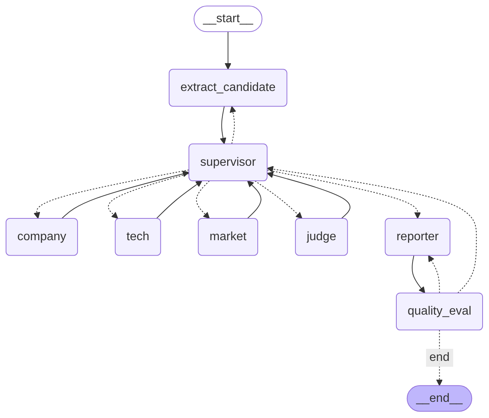
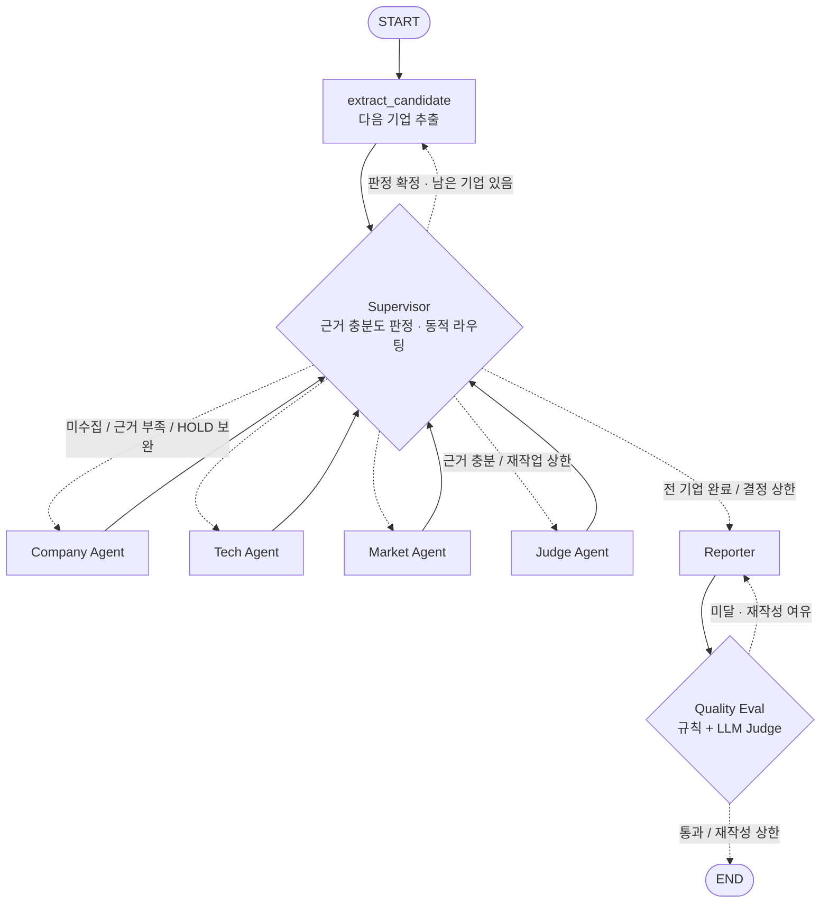

# Subject
본 프로젝트는 피지컬 AI·로보틱스 비상장 스타트업 5개사를 **기술·기업·시장** 관점에서 근거 기반으로 평가하고, 그 결과를 **기술 성숙도·시장성·이해관계자·도메인 적용** 4개 관점의 중립적 다관점 보고서로 정리하는 에이전트를 **Supervisor 패턴** 기반으로 설계/개발하는 프로젝트임.
(RAG 과제의 순차 파이프라인을 이어받아 검색 계층은 재사용하고, 조정 계층을 Supervisor로 재설계함)

## Overview
- **Objective** : 하나의 기업을 복수 관점에서 근거 기반으로 평가하고, 추천·우열 판정 없이 관점별 사실·리스크·정보 공백을 정리한 보고서 생성
- **Pattern** : Supervisor — 기업마다 확보 가능한 자료 편차가 커서(회사 자료 위주인 기업 / 제3자 자료가 풍부한 기업) "조사 → 근거 충분도 판정 → 부족한 관점만 재조사" 루프가 필요했고, 이를 사전 계획(Orchestrator)보다 State 기반 동적 라우팅으로 다루는 것이 적합했음
- **동적 처리** :
  - 고정 순서(tech → company → market) 대신, Supervisor가 매 단계 State(수집된 관점, 근거 충분도, 실행 횟수, 판정 상태)를 보고 다음 노드를 `add_conditional_edges`로 결정
  - 3개 관점 수집 후 근거가 부족한 관점만 골라 재작업 지시 → 기업마다 호출 순서와 횟수가 달라짐
  - 첫 HOLD 판정 시 점수 비율이 가장 낮은 관점만 보완 재조사 후 재판정
  - 보고서 품질 평가 미달 시 피드백을 담아 재작성 루프

## Selected Companies
| 기업 | 분야 |
|---|---|
| 트위니 | 자율주행 물류 로봇 |
| 뉴빌리티 | 실외 자율주행 배달 로봇 |
| 서울로보틱스 | 3D 라이다 기반 인프라 자율주행 |
| 마스오토 | 카메라 기반 E2E AI 화물 자율주행 |
| 엑스와이지 | 서비스 로봇 및 로봇 자동화 |

RAG 과제에서 구축한 문서 풀을 그대로 사용하여 패턴 변경 효과를 비교할 수 있도록 함.

## Features
- **문서 기반 정보 추출** : 회사소개서·기술 백서·뉴스·재무/공시 자료와 KIRIA·SPRi 산업 리포트를 파싱하고 메타데이터(`company`, `doc_type`, `source`, `url`, `date`) 자동 태깅, 기업·문서유형 필터 검색
- **Supervisor 근거 충분도 판정** : 관점별로 ① 실행 실패 ② 분석 없음 ③ 출처 2건 미만 ④ 항목 과반이 정보 부재(2점 이하) 중 하나라도 해당하면 근거 부족 → 해당 관점만 재작업 (관점당 최대 1회)
- **재작업 시 보강 검색** : 재작업 에이전트는 정보 부재 항목 중심의 보강 검색어와 확대된 검색 범위로 재조사
- **규칙 기반 투자 판단** : 7개 항목 가중 채점(100점), 과락 규칙(기술 차별성·창업자 1점 이하), PASS ≥ 75 / HOLD 60~74 / DROP < 60. 총점·판정은 코드로 계산하고 LLM은 사유만 작성 (재현성)
- **확증 편향 방지 전략** : 관점당 최소 2개 출처, 보고서 본문 인용 출처 3개 이상·단일 출처 비중 40% 이하, 기업별 리스크 서술 필수, 5개사 동일 항목·고정 순서 서술, 정보 부족은 "자료 부족"으로 명시
- **보고서 품질 평가 (Hybrid)** : 규칙 검사 + LLM Judge, 3개 항목(Groundedness·중립성·편향 통제)을 모두 통과해야 종료. 미달 시 피드백 반영 재작성 (최대 3회)
- **보고서 출력** : SUMMARY · 종합 스코어카드 · 기업별 4관점(+리스크) · REFERENCE 구성, Markdown + PDF(10쪽 이내 확인) 저장. REFERENCE는 코드가 번호 형식으로 생성

## Tech Stack
- Framework : LangGraph (StateGraph, `add_conditional_edges`), LangChain
- LLM/Generator : `gpt-4o-mini` (tech·company·market·judge 에이전트), `gpt-4o` (보고서 작성)
- LLM/Judge : `gpt-4o` (`OPENAI_JUDGE_MODEL`, 생성 에이전트와 다른 모델로 자기 채점 편향 완화, temperature 0, 구조화 출력)
- Retrieval : FAISS (기업·문서유형 메타데이터 필터 검색)
- Embedding : `BAAI/bge-m3`
- Observability : LangSmith Tracing + 결정 로그 JSONL
- Export : `markdown-pdf`, `pymupdf` (페이지 수 확인)

## Agents
| 구분 | 노드 | 역할 |
|---|---|---|
| 조정 계층 | **Supervisor** (`src/graph.py`) | State만 보고 다음 노드 결정(LLM 미사용 → 재현성), 근거 충분도 판정, 재작업·보완 재조사 지시, 결정 상한 관리, 결정 사유 로그 기록 |
| 조정 계층 | extract_candidate | 후보 기업 큐에서 다음 기업을 꺼내고 기업 단위 State 초기화 |
| 하위 에이전트 | Tech Agent (`tech.py`) | 기술 차별성·특허·TRL, 구매이유(도입 효과) → 기술 성숙도·도메인 적용 근거 |
| 하위 에이전트 | Company Agent (`company.py`) | 창업자·팀, 실적·주요 고객사, 수익모델 → 이해관계자·도메인 적용 근거 |
| 하위 에이전트 | Market Agent (`market.py`) | 시장 포지션·진입장벽, TAM·CAGR·규제 → 시장성 근거 |
| 하위 에이전트 | Judge Agent (`judge.py`) | 가중 채점·과락·판정, 판정 확정 시 기업별 결과를 `evaluations`에 누적 |
| 작성 | Reporter (`reporter.py`) | 5개사 평가 결과로 중립적 다관점 보고서 작성, 품질 피드백 반영 재작성 |
| 평가 | Quality Eval (`quality_eval.py`) | Hybrid 품질 평가 및 재작성 루프 분기 |

**통신 제약** : 하위 에이전트와 judge는 실행 후 항상 Supervisor로 복귀하며, 하위 에이전트 간 엣지는 없음. 에이전트 예외는 래퍼(`make_agent_node`)가 잡아 `FAIL`로 기록하고 Supervisor가 재시도 여부를 결정함.

## 보고서 품질 평가 (Hybrid)
| 항목 | 규칙 검사 (거부권) | LLM Judge (1~5점, 4점 이상 통과) |
|---|---|---|
| Groundedness | 본문 서술 70% 이상에 `[n]` 출처 번호, REFERENCE에 없는 번호 인용 금지, REFERENCE 항목이 실제 검색 출처와 대응 | 수치·사실이 평가 결과·출처와 일치하는가 |
| 중립성 | 추천·우열·순위 표현 금지 (REFERENCE 제외) | 은근한 편들기, 서열화, 투자 권유 뉘앙스 |
| 편향 통제 | 인용 출처 3개 이상, 단일 출처 비중 ≤ 40%, 도메인 편중 ≤ 60%, 기업별 리스크 서술 | 리스크 축소, 회사 자체 자료만으로 단정 여부 |

- 항목 통과 = 규칙 통과 **AND** LLM 통과. 규칙에서 떨어진 항목은 LLM을 호출하지 않음 (비용 절감, 결정성)
- LLM Judge 호출 실패 시 통과시키지 않고 미달 처리, 오류는 `last_error`에 기록
- 미달 시 항목별 사유를 `eval_result.feedback`으로 Reporter에 전달 → 이전 보고서 + 피드백으로 재작성
- 재작성 최대 3회, 이후에도 미달이면 현재 보고서로 종료

## State Schema
코드: `src/state.py` — `[A. 작업 페이로드]`와 `[B. 제어 메타데이터]` 구역 분리

- **제어 vs 페이로드 분리** : 페이로드 = `candidates`, `current_startup`, `perspectives`, `total_score`, `decision`, `report`, `eval_result`, `evaluations`. 제어 = `next_agent`, `agent_counts`, `report_revision_count`, `trace_id`, `step_count`, `retry_count`, `node_status`, `last_error`. Supervisor 라우팅은 제어 필드와 관점 결과의 요약 지표(출처 수, 정보 부재 항목 수)만으로 결정
- **관측성 위치** : 결정과 사유 전체 이력은 State 밖 외부 로그에 기록 — Supervisor·품질 분기 결정은 `outputs/decision_log_{trace_id}.jsonl`, 품질 평가 항목별 상세는 `outputs/logs/{trace_id}.jsonl`. State에는 최신 결정(`next_agent`)과 사유 1건(`node_status["supervisor"]`)만 유지
- **지속성 비용** : 검색 청크 원문은 State에 저장하지 않고 출처 문자열만 저장. `perspectives`는 기업이 바뀔 때 초기화되어 현재 기업 1개분만 유지, 확정 결과만 `evaluations`에 기업당 1건 누적(최대 5건). 보고서는 최신본 1개만 유지
- **상관** : `trace_id`를 LangSmith run metadata, 결정 로그 파일명, 품질 평가 로그 파일명에 공통으로 사용
- **재개/복구** : 에이전트 단위 장애 격리 — 예외 시 `node_status[agent]="FAIL"`, `last_error` 기록 후 Supervisor가 재시도(실행 상한 내) 또는 정보 부재로 처리하고 진행. `agent_counts`, `retry_count`, `report_revision_count`로 재시도 이력 유지
- **동시 처리** : Supervisor가 하위 에이전트를 순차 실행하므로 동시 쓰기 필드 없음. 기업별 결과가 누적되는 `evaluations`에는 `operator.add` 리듀서를 적용해 기존 기록을 덮어쓰지 않고 추가
- **종료 보장** : 관점당 실행 상한 `MAX_AGENT_RUNS=2`, HOLD 보완 재조사 1회(`retry_count`), Supervisor 결정 상한 `MAX_SUPERVISOR_STEPS=60`, 보고서 재작성 상한 `MAX_REVISIONS=3`, LangGraph `recursion_limit=150`

## Architecture




## Directory Structure
```text
├── data/                     # 문서 풀
│   ├── companies/            #   기업별 회사소개서·기술문서·뉴스·재무 자료 (5개사)
│   └── market/               #   공통 산업 리포트 (KIRIA, SPRi)
├── src/
│   ├── graph.py              # 조정 계층: Supervisor 라우팅·근거 충분도·종료 가드·그래프 조립
│   ├── state.py              # State Schema
│   ├── vectorstore.py        # bge-m3 임베딩 + FAISS 벡터스토어
│   └── agents/               # 하위 에이전트
│       ├── tech.py · company.py · market.py · judge.py
│       ├── reporter.py       #   보고서 작성 + PDF 변환
│       └── quality_eval.py   #   보고서 품질 평가 (Hybrid)
├── prompts/                  # 에이전트별 프롬프트 템플릿
├── tests/                    # 품질 평가 단위 테스트
├── outputs/                  # 보고서(md/pdf), 결정 로그
├── app.py                    # 실행 스크립트
└── README.md
```

## Usage
```bash
pip install -r requirements.txt
cp .env.example .env     # OPENAI_API_KEY, LANGSMITH_API_KEY 입력
echo "OPENAI_JUDGE_MODEL=gpt-4o" >> .env   # 품질 평가 Judge 모델 (미지정 시 OPENAI_MODEL 사용)

python app.py                                 # 5개사 평가 → 보고서 생성 → 품질 평가
python -m pytest tests/test_quality_eval.py   # 품질 평가 단위 테스트 (API 키 불필요)
```
실행 결과는 `outputs/`에 보고서(md, pdf)와 결정 로그(jsonl)로 저장되며, LangSmith 프로젝트에서 동일 `trace_id`로 실행 흐름을 확인할 수 있음.

## Contributors
- 김영제 : 보고서 품질 평가 노드 (규칙 검사 + LLM Judge Hybrid), 품질 평가 프롬프트·테스트, 투자 판단 에이전트
- 김지훈 : README 작성, 아키텍처 다이어그램, 산출물 검토 및 전체 보조
- 서승현 : 보고서 작성 에이전트, 보고서 프롬프트 (중립성·인용 형식·목차), PDF 변환
- 이진서 : Supervisor 패턴 그래프 구현, 품질 Loop 연결, LangSmith 트레이싱 설정, 기업 에이전트
- 우성윤 : State Schema 설계 (페이로드/제어 메타데이터 분리, 관점별 결과 구조화 PerspectiveResult)
